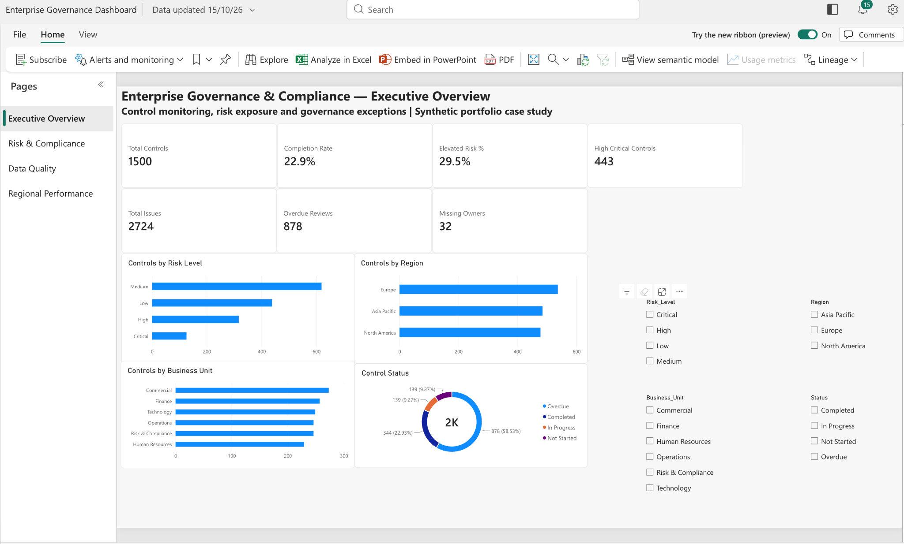
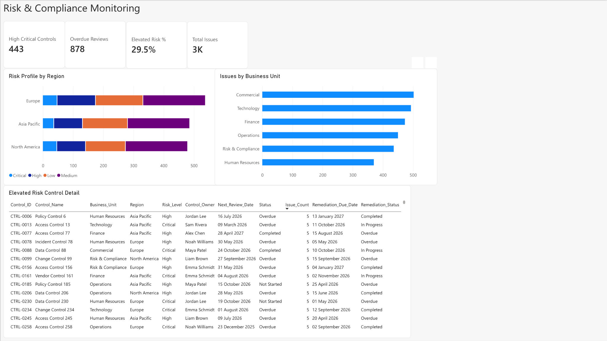
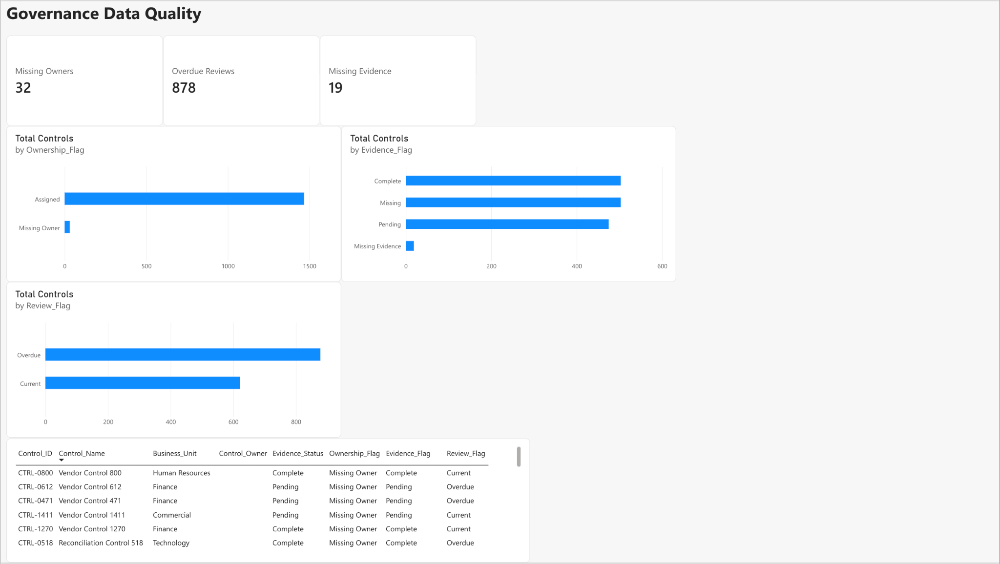
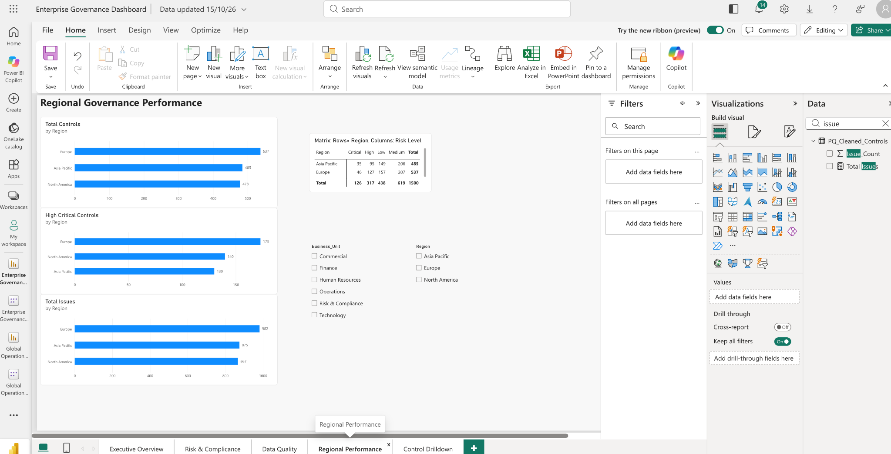
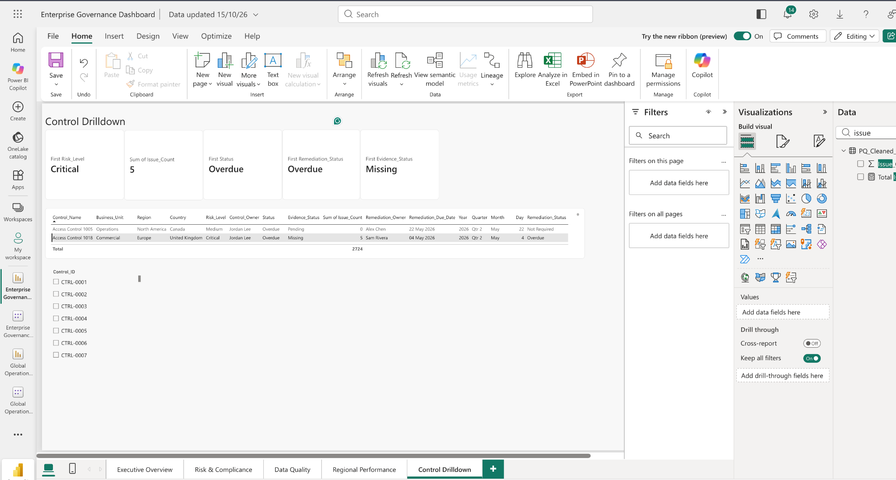
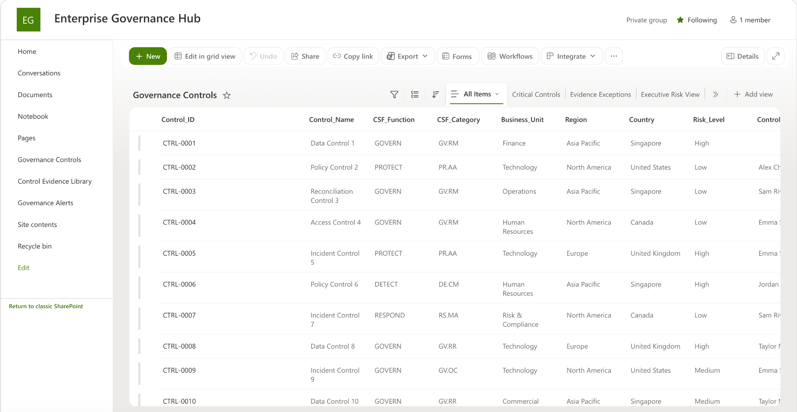
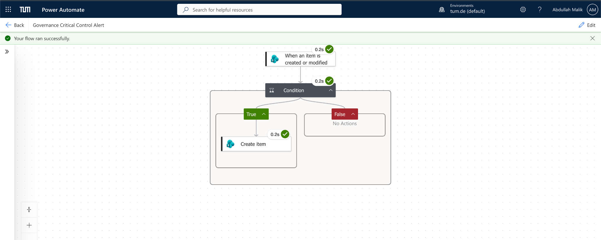
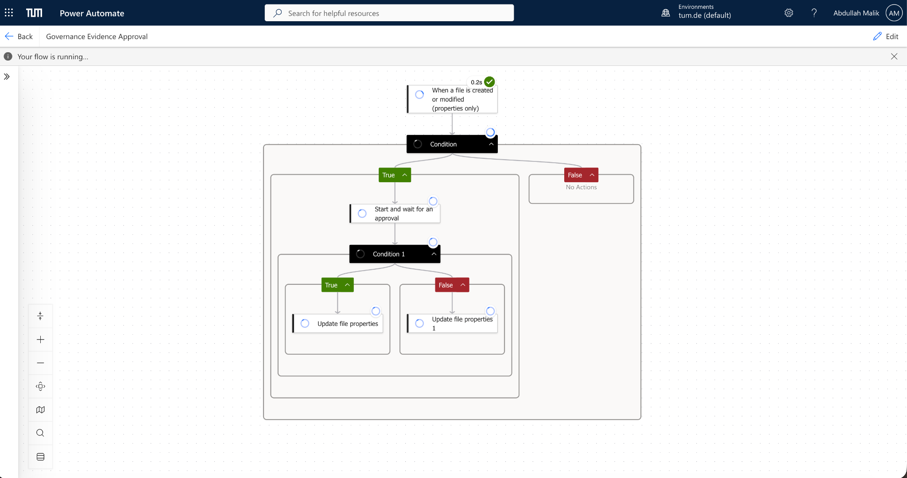

# Enterprise Governance & Compliance Analytics Platform

End-to-end portfolio project demonstrating governance data management, control monitoring, workflow automation, evidence management, and executive reporting using the Microsoft analytics stack.

> **Portfolio note:** All control records and business data in this project are synthetic and were created for demonstration purposes.

## Live Power BI Dashboard

**[Open the interactive Enterprise Governance Dashboard](https://app.powerbi.com/view?r=eyJrIjoiNTgxZWYwODctNDg5Mi00N2EwLThlNzUtODRjNjEzN2YzNDE2IiwidCI6IjVkN2I0OWU5LTUwZDItNDBkYy1iYWIxLTE0YTJkOTAzNTQyYyIsImMiOjh9)**

The repository also includes static screenshots so the project remains reviewable without opening Power BI.

## Project Summary

This project simulates an enterprise governance environment containing **1,500 control records** across multiple business units, regions, risk levels, review states, evidence states, and remediation statuses.

The solution was designed as an integrated workflow:

**Excel / Power Query → SharePoint → Power Automate → Power BI → Executive Reporting**

The objective was to create a practical governance operating model that can identify exceptions, centralize evidence, automate follow-up, and surface management-level insights.

## Dashboard Preview

### Executive Overview


### Risk & Compliance


### Data Quality


### Regional Performance


### Control Drilldown


## What I Built

### Excel & Power Query
- Structured and cleaned a 1,500-record governance control inventory.
- Standardized text, dates, countries, and governance fields.
- Created validation logic for missing ownership, missing evidence, overdue reviews, and elevated-risk controls.
- Produced a cleaned dataset used as the analytical source for Power BI.

### SharePoint
Built an **Enterprise Governance Hub** containing:
- `Governance Controls` list
- `Control Evidence Library`
- `Governance Alerts` list
- filtered operational views for critical controls, overdue reviews, evidence exceptions, remediation items, pending approvals, and approved evidence

The evidence library includes metadata-driven document management, approval status tracking, and version history.



### Power Automate
Implemented two working workflows:

1. **Governance Critical Control Alert**
   - Trigger: SharePoint control created or modified
   - Logic: detects Critical risk or Overdue status
   - Action: automatically creates a centralized governance alert record in SharePoint

2. **Governance Evidence Approval**
   - Trigger: evidence file created or modified
   - Logic: starts when `Approval_Status = Pending Review`
   - Action: routes evidence through Approve/Reject workflow and automatically updates SharePoint metadata

> Email and Teams notification channels were restricted by the university Microsoft 365 tenant, so the alert workflow uses a SharePoint exception queue while preserving the same automation logic.

#### Critical Control Alert — Successful Run


#### Evidence Approval Workflow


### Power BI
Built a **five-page interactive governance dashboard**:

1. **Executive Overview** — control population, completion rate, elevated risk, overdue reviews, issues, ownership exceptions, and management slicers
2. **Risk & Compliance** — regional risk profile, issues by business unit, and elevated-risk control detail
3. **Data Quality** — missing ownership, missing evidence, overdue reviews, validation breakdowns, and exception detail
4. **Regional Performance** — controls, high/critical controls, issues, and risk matrix by region
5. **Control Drilldown** — control-level governance profile for detailed investigation

## Key Portfolio Metrics

- **1,500** synthetic governance control records
- **5** interactive Power BI pages
- **3** SharePoint governance components
- **2** tested Power Automate workflows
- Automated exception logging and evidence approval lifecycle

## Technology

`Excel` · `Power Query` · `Power BI` · `SharePoint` · `Power Automate` · `PowerPoint`

## Repository Structure

```text
├── 01_Enterprise_Governance_FINAL.xlsx
├── Enterprise_Governance_Dashboard.pbix
├── sources/
│   ├── SharePoint_Controls_Import.csv
│   └── SharePoint_Document_Metadata_Import.csv
├── screenshots/
│   ├── executive-overview.png
│   ├── risk-compliance.png
│   ├── data-quality.png
│   ├── regional-performance.png
│   ├── control-drilldown.png
│   ├── sharepoint-governance-controls.png
│   ├── power-automate-critical-alert-success.png
│   └── power-automate-evidence-approval-running.png
└── README.md
```

## Skills Demonstrated

- Governance and compliance analytics
- Data quality controls and exception management
- Power Query transformation
- SharePoint list and document-library design
- Workflow automation
- Approval-process design
- KPI and management reporting
- Power BI semantic modeling and DAX
- Executive-level data storytelling

## Disclaimer

This is a **synthetic portfolio project**. It does not contain confidential employer information, client data, or real enterprise control records.
